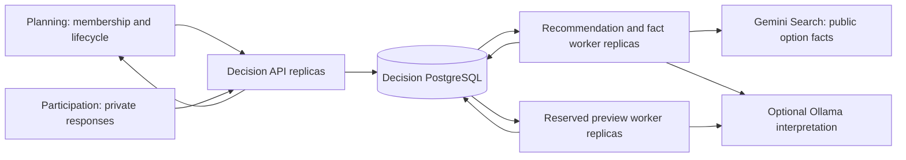

# Decision storage and worker design

Status: implemented on `feat/decision-postgres-workers`, 15 October 2026.
This document records the scope, alternatives, operating procedures and evidence
for PostgreSQL persistence and independently deployable Decision processes.
It supplements the [lifecycle guide](../../integration/BACKEND_HARDENING.md).
The subsequent [efficiency report](../../integration/DECISION_EFFICIENCY_REPORT.md)
records scoring setup reuse, lightweight reads/readiness, and adaptive idle polling
with before/after measurements and their latency trade-offs.

## Problem and scope

The earlier Decision deployment kept runs, queue state and a semantic cache in a
local SQLite database. Its HTTP process started background threads itself. That
was sufficient for a local demonstration, but independent containers could not
share a supported queue/store, and API scaling also multiplied execution workers.
Workers automatically failed unfamiliar implementation versions, preventing a
safe period in which two releases shared the same database.

This milestone introduces shared PostgreSQL persistence, separate API and worker
roles, reserved preview capacity, compatible-version claiming, migration and
recovery checks, and reproducible load evidence. It preserves public API shapes,
the existing matcher and private/public result boundaries.

Cloud provisioning, Kubernetes manifests/HPA, automated cloud delivery, Redis,
provider-wide quotas/circuit breakers, cost accounting, cache retention and human
accuracy evaluation remain separate work. The existing GitHub workflow is CI;
it does not deploy a cloud environment.

## Architecture and ownership



The arrows into Decision represent snapshot retrieval; workers execute only the
snapshots saved in their claimed job. They do not reread mutable plan/member data.

| Component | Owns | Does not own |
| --- | --- | --- |
| Planning | Identity, authorisation, published/final definitions, confirmation | Private Decision processing artifacts |
| Participation | Drafts, submissions, frozen responses, RSVPs | Recommendation execution |
| Decision API | Internal API validation, immutable snapshot capture, job admission, filtered reads | Model invocation in `api` mode |
| Decision workers | Interpretation, supported adapter execution, evidence collection | Public member authorisation or lifecycle mutation |
| Decision PostgreSQL | Job claims, persisted inputs/results, semantic cache, worker presence, migration/import metadata | Planning or Participation tables |

Local Compose uses a dedicated Decision PostgreSQL service and volume. Cloud
deployment can use a managed PostgreSQL instance with a separately owned Decision
database and credentials. A shared physical server is possible while preserving
logical ownership; cross-service table joins are deliberately absent.

## Storage decisions and alternatives

| Choice | Reason for this milestone | Alternative and when to reconsider |
| --- | --- | --- |
| PostgreSQL as durable store | Multiple machines can transact against one authoritative queue/result store; the project already operates PostgreSQL | SQLite stays as a standalone/local fallback. Shared SQLite WAL is unsuitable across independent networked hosts; SQLite documents its same-host requirement. A single persistent SQLite worker would limit this milestone's horizontal scaling |
| PostgreSQL-backed queue | Enqueue identity, queue state and artifact completion share transactions; avoids a second distributed system and a database/broker dual-write gap | Redis/RabbitMQ/SQS become useful for more advanced routing, much larger queue throughput or integration with a managed messaging platform. They require delivery/acknowledgement and idempotency design alongside the result database |
| Pooled synchronous Psycopg | Existing HTTP/worker code is synchronous; pooled connections reuse sessions and bound per-process database demand | Async I/O becomes useful if measured API concurrency or provider multiplexing justifies the change. An async rewrite would not remove provider capacity limits or CPU costs |
| Canonical JSON in TEXT payload columns | Preserves historical artifacts and exact canonical execution specifications across both adapters; current queries primarily use relational IDs/state/timestamps | JSONB is appropriate if production queries need indexed exploration of artifact contents. That would require a versioned migration and privacy-aware query requirements |
| One application image, explicit roles | Keeps API and workers on the same implementation while allowing separate resource budgets and replica counts | Separate images can reduce dependency surface if provider/runtime dependencies grow substantially |
| PostgreSQL semantic cache | Durable reuse across independent workers without adding infrastructure | Add Redis if cache latency/traffic becomes material in measured database load; keep completed authoritative artifacts durable |
| Relational queue metadata | Unique identities, state/lease predicates and atomic artifact completion fit the existing SQL operating model | MongoDB or DynamoDB can implement conditional claims with suitable transaction design, but introduce another data-access/operations model. Reconsider for a concrete access pattern or hosting constraint |
| Small in-repository worker runtime | Three bounded read-only job kinds already have tested lease, retry and identity contracts | Celery can supply broker-backed routing/scheduling as requirements grow. Temporal fits durable multi-step workflows. Both add infrastructure and operating contracts; the custom queue also carries maintenance responsibility and must retain its concurrency/recovery tests |

Relevant primary documentation: [SQLite WAL constraints](https://sqlite.org/wal.html),
[PostgreSQL locking and SKIP LOCKED](https://www.postgresql.org/docs/16/sql-select.html#SQL-FOR-UPDATE-SHARE),
and [Psycopg connection pools](https://www.psycopg.org/psycopg3/docs/advanced/pool.html).

## Persistence model

| Table | Meaning and lifecycle |
| --- | --- |
| `jobs` | Immutable input fingerprint, snapshots and execution specification; mutable queue state, attempts, lease token and timing |
| `runs` | First completed artifact for a job, preserving its ID, references, processing evidence and result |
| `semantic_cache` | Exact provider-method/input/specification key and accepted response |
| `worker_presence` | Ephemeral capability registrations, slot count and shared-clock heartbeat |
| `decision_schema_migrations` | Applied SQL filenames/checksums |
| `import_markers` | Transactional record of the completed legacy SQLite import |

Operational indexes cover ready jobs, pending work, recent completions and expired
worker registrations. Full immutable payloads are excluded from those indexes.
New runs share their job ID. Historical artifacts can predate the queue, so the
import preserves those IDs without inventing job records or a mandatory job FK.
New artifact/job consistency is enforced by their single completion transaction.
The cache and completed history currently have no automatic retention policy.
Database growth and private-data retention need explicit monitoring and policy;
these tables are not advertised as a bounded cache.

## Job identity and execution guarantees

An input key hashes canonical planning/response snapshots plus the processing
version, implementation hash, provider/model revision, job kind and execution
policy. A duplicate POST reuses the same ID/result before expensive processing.
The key is content-based; it is not based only on a round UUID.

Queue transitions are `queued → running → completed`, with transient failures
returning to `queued` after backoff. Three unsuccessful attempts produce `failed`.
An explicit retry of a failed job retains its ID; a successful artifact remains
unchanged. A new model/code/input version creates a different job key.

Admission takes a short PostgreSQL transaction advisory lock around duplicate
lookup, the global 128-pending-job capacity check and insertion. This prevents
replicas from over-admitting simultaneously. Duplicate requests remain readable
at capacity. The lock is released before worker execution or provider calls.

Workers claim matching versions/kinds using `FOR UPDATE SKIP LOCKED`. A locked
job does not make another worker wait for its execution. Claims are ordered by
creation time and ID among available matching jobs; concurrent row skipping and
delayed retries mean this is not a strict global completion order.

Each claim has a new random lease token. Heartbeats renew it using PostgreSQL's
clock; the default lease is 300 seconds. After an ungraceful death, a compatible
worker can reclaim expired work. Completion updates the claimed job and inserts
its artifact in one transaction, conditional on that token. A superseded worker
cannot complete, fail, renew or release the replacement's claim.

This provides at-least-once execution with a fenced authoritative completion.
A crash can repeat a model call; there is no promise of exactly-once provider
billing. Provider operations must remain read-only or independently idempotent.
On graceful shutdown workers stop claiming, give active work a short drain
window, and surrender their own unfinished claims. The old token is invalidated.

## Process roles and capacity

| Role | Behaviour |
| --- | --- |
| `api` | HTTP validation/admission/reads; creates no execution threads |
| `worker` | Executes configured kinds; HTTP surface exposes only health and authenticated metrics |
| `all` | Backwards-compatible standalone API plus workers, useful for local SQLite work |
| `migrate` | Applies SQL migrations and optionally imports a stopped legacy SQLite file |
| `retire` | Explicitly fails pending jobs of one retired implementation after active workers/live leases are gone |

Compose runs `decision` in API mode, `decision-worker` for recommendation/fact
collection, and `decision-preview` for previews. The API receives no Gemini key.
Only the recommendation/fact worker receives it. Preview isolation reserves
capacity so slow fact collection cannot occupy every execution slot. Fairness
between recommendations and fact collection within their shared pool is FIFO;
separate pools for those kinds can be introduced if measurements justify it.

`DECISION_WORKERS` is slots **per worker process**, not a global limit. Compose's
preview pool uses `DECISION_PREVIEW_WORKERS` separately. Each process defaults to
at most eight database connections (`DECISION_DB_POOL_SIZE`, configurable 1–32).
Plan the sum of all API/worker pools against database capacity before scaling.
These limits do not enforce a shared Gemini quota or spending budget.

Use multiple worker processes/containers for CPU parallelism. Threads are useful
for blocking provider I/O; more threads do not guarantee faster Python matching.
The job deadline defaults to 180 seconds and provider timeouts respect its budget.
Per-process in-flight semantic cache coalescing remains local; independent cache
misses can make duplicate provider calls before the first shared value is stored.

## Cache and external evidence

Semantic cache keys include exact inputs and the execution specification.
The first persisted response wins; reads return independent Python values.
Caching is private and is not exposed through public result views. Rules-only
processing generally does not use this model-response cache.

Gemini collection results are persisted job artifacts, not semantic cache rows.
Repeating an identical successful collection reuses that artifact. Current expiry
validation and explicit fact review remain in force, but a dedicated refresh
generation/freshness API is still needed for changing prices or offers. Do not
treat job deduplication as proof that external information remains current.

## Releases and version compatibility

API and workers compute their specifications from the same image/configuration.
Workers claim only supported exact specifications and leave other versions alone.
New workers no longer automatically fail unfamiliar jobs. During rolling releases,
retain old worker replicas until old jobs finish, and bring up new workers before
routing new API traffic to them. Readiness requires fresh worker registrations
for that API's recommendation and preview specifications. Fact collection checks
its own capability before admission and returns a safe unavailable code if absent.

SQL migrations run as a one-shot Compose dependency before API/worker startup.
Runtime PostgreSQL processes verify installed migration checksums without running
DDL. Future migrations must remain compatible with overlapping application
versions (expand, migrate, then contract). Checksum history does not itself prove
that a schema change is backwards compatible.

An old queued version with no remaining compatible workers stays pending rather
than silently executing new code. Metrics expose `pending_without_worker` and
`pending_implementations`. Operators can restore that release or explicitly retire
its hash after draining/stopping it:

```sh
docker compose -f compose.integration.yaml exec -T decision python -m decision_service.service --role retire --implementation-hash <exact-old-64-character-hash>
```

Retirement refuses a matching live worker registration or an unexpired running
lease. It preserves artifacts and marks only pending work `EXECUTION_VERSION_RETIRED`.
Resubmit original inputs through the current API to create a current-version job.

## First migration from SQLite

1. Quiesce requests and stop the old Decision writer before the first import:

   ```sh
   docker compose -f compose.integration.yaml stop decision
   docker compose -f compose.integration.yaml up -d --build --wait --wait-timeout 180
   ```

2. Compose creates `decision-postgres-data`. The one-shot `decision-migrate` mounts
   the original `decision-data` volume read-only at `/legacy`.
3. The importer copies the database and any WAL into a private temporary directory
   and opens a consistent transaction there. SQLite can reconstruct writable WAL
   coordination files without changing the source. A source file change during
   copying aborts the import; the source writer must remain stopped throughout.
4. Runs, job records and semantic cache entries are imported in one PostgreSQL
   transaction. IDs, completed payloads and fingerprints are preserved. Conflicting
   destination records abort the entire import; they are never overwritten.
5. Pending legacy jobs are marked `EXECUTION_VERSION_CHANGED` because this release
   has a different implementation hash. Resubmit their original API requests.
   Historical completed results remain readable without their old worker release.
6. A marker commits with the data; subsequent imports are no-ops. A missing SQLite
   file is valid for a fresh installation and does not record a completed import.

The source volume is retained. Never remove volumes to resolve a migration error.
Inspect the migration container's error, fix the cause and rerun it. Local migration
verification imported 70 artifacts and 46 job records; this count describes that
checkout's data, not a required count for other environments.
All 70 historical artifact IDs, fingerprints and payloads were subsequently
compared with the read-only source and verified unchanged.

## Rollback, backups and security

Before the first migration, take an infrastructure snapshot/backup of the stopped
legacy volume. After migration, back up the PostgreSQL database and test restoration
into a separate database. A Docker volume is persistence, not a backup.

Example local PostgreSQL backup and isolated restore rehearsal (contains private
member processing data; keep the file access-restricted and out of Git):

```sh
umask 077
docker compose -f compose.integration.yaml exec -T decision-db pg_dump -U decision -d decision -Fc > /private/tmp/decision-backup.dump
docker compose -f compose.integration.yaml exec -T decision-db createdb -U decision decision_restore_check
docker compose -f compose.integration.yaml exec -T decision-db pg_restore -U decision --no-owner --no-privileges -d decision_restore_check < /private/tmp/decision-backup.dump
docker compose -f compose.integration.yaml exec -T decision-db psql -U decision -d decision_restore_check -c 'SELECT count(*) FROM runs;'
```

Use a uniquely named restore database in repeated rehearsals; the example does not
overwrite an existing database. Verify artifacts, queue state and application reads
against the restored database before accepting a backup. Keep rehearsal workers
disconnected from the production queue. The procedure is documented here; the
automated suite separately verifies import/restart recovery, not a managed-cloud
backup service or its point-in-time recovery.

If the initial import fails, its transaction rolls back and the stopped SQLite
deployment can be restarted using the previous release. Once new writes have
reached PostgreSQL, the old SQLite copy is stale: switching back would lose access
to new Decision records. Prefer a forward fix or a compatible PostgreSQL-enabled
release rollback. Do not claim that retaining the old volume synchronises it.

Production must provision database credentials/TLS, access-restricted backups and
internal networking. The local Compose passwords are development defaults.
Separate migration-owner credentials from runtime DML credentials in production;
runtime needs access to existing tables, including read access to migration history.
Internal metrics and operational commands require private network access; HTTP
metrics require the internal token. SQL is parameterised and operational metrics
exclude raw questions, answers, credentials and evidence.

## Observability and scaling decisions

`GET /internal/metrics` reports job counts, pending kinds/age, unmatched versions,
worker processes/slots and cache entry count. Latency/retry summaries use the most
recent 500 terminal jobs, so they are bounded samples rather than lifetime counters.
Queue wait means creation to the latest claim, including any retry/backoff time.
Last-attempt duration is latest claim to terminal completion/failure. Neither is
a complete per-attempt tracing history. Metric polling does not invoke providers.

Readiness uses a constant-size database ping; historical counts are diagnostic
only. Completed result reads use one consistent join and exclude frozen input
payloads. Idle polls back off from 250 ms to a maximum one second and reset after
work/local notification. This can add up to one second of polling delay when an
independent API admits work to an idle worker. Exhausted expired leases are failed
at startup and every five seconds; reclaimable leases stay on the claim path.

Workers refresh presence every five seconds. Registrations are considered active
for 30 seconds; worker readiness becomes unhealthy if its own presence cannot be
renewed for 15 seconds. A hard-killed process can therefore appear active briefly.
Liveness is a basic HTTP process check, not an assertion of provider availability.

Future Kubernetes mapping: API Deployment, recommendation/fact worker Deployment,
preview worker Deployment, internal Services and a migration Job with managed
PostgreSQL. Scale API capacity against request demand; scale workers against queue
age, throughput, database connections and provider capacity. CPU-only autoscaling
can misread an I/O-bound backlog. Kubernetes and cloud CD are not implemented here.

## Validation and reproducibility

The default unittest suite keeps SQLite coverage. PostgreSQL-specific tests run
when `DECISION_TEST_DATABASE_URL` is set; they create/drop isolated schemas with
generated `decision_test_` names. They do not truncate application tables.

```sh
python3.12 -m pip install -r decision_service/requirements-test.txt
python3.12 -m unittest discover -s decision_service/tests -t . -q
python3.12 -m integration.benchmark_decision_service --jobs 48 --delay-ms 100 --output /private/tmp/decision-load.json
python3.12 -m integration.benchmark_decision_service --jobs 48 --delay-ms 0 --output /private/tmp/decision-rules-load.json
python3.12 integration/test_http_lifecycle.py
```

Set `DECISION_TEST_DATABASE_URL` to an explicitly approved test-capable database for
the benchmark. It creates/drops only generated `decision_bench_` schemas. The caller
needs schema privileges; do not point it at production. Run inside the Decision
image on the Compose network if no PostgreSQL host port is exposed. CI installs
the pinned Psycopg packages, runs real PostgreSQL tests, exercises the benchmark
and uploads its JSON report. No external model calls are part of those checks.

The [local evidence report](../../integration/DECISION_LOAD_REPORT.md) records
the workload, measured results, crash behaviour and limitations. It distinguishes
simulated provider wait from rules-only throughput. It does not establish
real Gemini latency, semantic accuracy, large-roster capacity or multi-node cloud
performance. Those require staging measurements and independently reviewed data.

## Code map and revisit criteria

| Code | Responsibility |
| --- | --- |
| `service/store.py` | Shared queue/artifact operations, SQLite adapter, metrics and worker registrations |
| `service/postgres_store.py` | Pool, PostgreSQL transactions/clock, migration verification, legacy import |
| `service/migrations/` | Append-only checked-in SQL versions |
| `service/jobs.py` | Input specifications, admission-only queue, execution workers, heartbeat/fencing |
| `service/__main__.py` | Explicit process roles and provider configuration |
| `service/http_api.py` | Filtered internal API, readiness and operational endpoints |
| `tests/test_postgres_store.py` | Database concurrency, migration, cache, rollout and fencing contracts |
| `tests/test_api_workers.py` | API separation, readiness and preview isolation |
| `integration/benchmark_decision_service.py` | Real HTTP/process load and SIGKILL recovery harness |

Revisit the queue backend when PostgreSQL admission/claim overhead is a measured
bottleneck or messaging requirements grow. Revisit caching when traffic, retention
or provider spending justifies a dedicated cache and distributed miss coalescing.
Revisit worker isolation when a job kind monopolises the shared background pool.
Require evidence for each additional infrastructure component and retain the
immutable-input, private-evidence and fenced-completion contracts.
