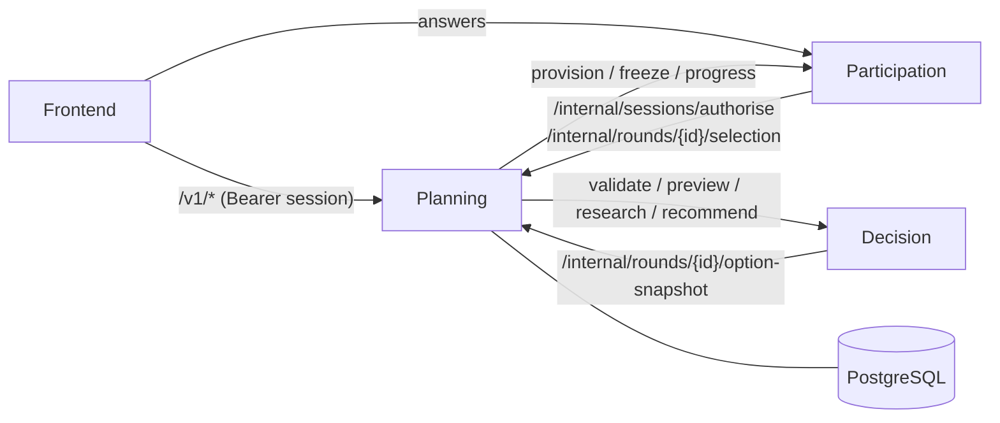
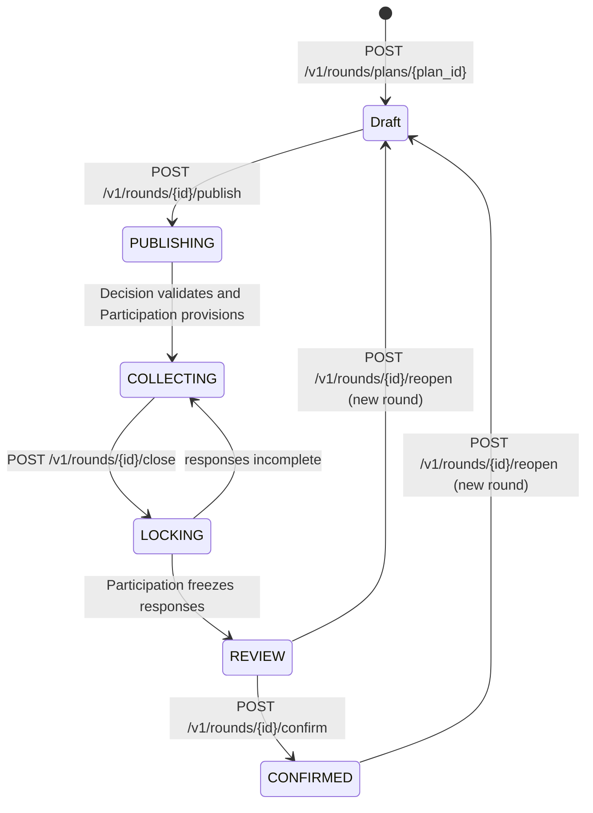

# Planning Service

The planning service is the backend that owns **plans** for What2Do. A plan is a group decision, such as where to eat or where to travel. The service stores the plan's options, questions and members, issues guest sessions, and runs each **round** of the decision through its lifecycle:

```
draft → publish → collect → close → recommend → confirm
```

It is the only browser-facing entry point to the **Decision** service. Answers themselves are submitted to the **Participation** service directly. Planning tells Participation which form to collect and asks Decision for validation, previews, research and recommendations.

Written in Go 1.27 on the standard library `net/http` router, with GORM over PostgreSQL 16.

---

## Contents

- [Quick start](#quick-start)
- [Configuration](#configuration)
- [Architecture](#architecture)
- [Authentication and access control](#authentication-and-access-control)
- [The round lifecycle](#the-round-lifecycle)
- [API reference](#api-reference)
- [Errors](#errors)
- [Rate limits](#rate-limits)
- [Data model](#data-model)
- [Database migrations](#database-migrations)
- [Operations](#operations)
- [Testing](#testing)
- [Known limitations](#known-limitations)

---

## Quick start

### Prerequisites

- Go **1.27.1** or later (`go.mod`). The Docker image builds with 1.27.2.
- Docker, for the local PostgreSQL 16 database.
- Running **Decision** and **Participation** services, for anything past drafting. Plan, member, question and option CRUD work without them. Publishing a round and every later lifecycle step do not.

### 1. Start PostgreSQL

`docker-compose.yml` starts only the database. It listens on `localhost:5433` with user `planning_user`, password `planning_pass` and database `planning_db`.

```bash
docker compose up -d postgres
```

### 2. Create a `.env` file

The service loads a `.env` file from the working directory if one exists. Otherwise it uses the process environment.

```dotenv
DB_PASSWORD=planning_pass
INTERNAL_API_TOKEN=change-me-to-a-shared-secret   # at least 16 characters
DECISION_BASE_URL=http://localhost:8000
PARTICIPATION_BASE_URL=http://localhost:3000
PUBLIC_APP_URL=http://localhost:15173
```

The other database settings default to the docker-compose values. See [Configuration](#configuration).

### 3. Run the service

```bash
go run ./app/api
```

On start-up the service:

1. connects to PostgreSQL,
2. applies any pending [migrations](#database-migrations),
3. seeds the question presets,
4. starts the [reconcile loop](#reconcile-loop), and
5. listens on **`:8080`**.

Check it's up:

```bash
curl http://localhost:8080/health          # liveness
curl http://localhost:8080/health/ready    # readiness, including the database
```

### 4. Try the API

```bash
# Register a guest user. The response holds a session token, shown only once.
curl -s -X POST http://localhost:8080/v1/users \
  -H 'Content-Type: application/json' \
  -d '{"username":"alice"}'
# → {"id":"<user-id>","username":"alice","session_token":"<token>"}

# Create a plan with yourself as organiser
curl -s -X POST http://localhost:8080/v1/plans \
  -H "Authorization: Bearer <token>" \
  -H 'Content-Type: application/json' \
  -d '{"title":"Friday dinner","plan_category":"DINING","plan_state":"DRAFT","organiser_id":"<user-id>"}'
```

### Running with Docker

```bash
docker build -t planning-service .
docker run --rm -p 8080:8080 --env-file .env \
  -e DB_HOST=host.docker.internal planning-service
```

The build runs `go test ./app/internal/...` before compiling, so a failing unit test fails the build. Database-backed tests skip themselves there. The final image is `distroless/static-debian12:nonroot` with a built-in `HEALTHCHECK`.

To build a coverage-instrumented binary for end-to-end coverage runs, pass `--build-arg GO_COVER=1`.

---

## Configuration

All configuration comes from environment variables, optionally loaded from `.env`.

| Variable | Default | Notes |
|---|---|---|
| `DATABASE_URL` | — | Full PostgreSQL connection string. When set, the `DB_*` variables below are ignored. |
| `DB_HOST` | `localhost` | |
| `DB_PORT` | `5433` | Matches `docker-compose.yml`. |
| `DB_USER` | `planning_user` | |
| `DB_PASSWORD` | — | **Required** unless `DATABASE_URL` is set. Start-up fails without it. |
| `DB_NAME` | `planning_db` | |
| `DB_SSLMODE` | `disable` | |
| `INTERNAL_API_TOKEN` | — | **Required, at least 16 characters.** It's shared with Decision and Participation, sent as `x-internal-token` on calls to them and checked on Planning's `/internal/*` routes. Start-up fails if it is shorter. |
| `DECISION_BASE_URL` | `http://localhost:8000` | Base URL of the Decision service. |
| `PARTICIPATION_BASE_URL` | `http://localhost:3000` | Base URL of the Participation service. |
| `PUBLIC_APP_URL` | `http://localhost:15173` | Frontend origin used to build invitation links. |

The listen port is fixed at `8080` in `main.go`.

---

## Architecture

### Where Planning sits



All service-to-service calls carry `x-internal-token` and forward the caller's `x-request-id`. Upstream calls time out after 15 seconds, and responses over 2 MB are rejected.

**Calls Planning makes**

| Service | Endpoint | Used for |
|---|---|---|
| Decision | `POST /internal/planning/validate` | Validating a round definition on publish, and in readiness checks |
| Decision | `POST /internal/rounds/{id}/recommendations` | Starting a recommendation run |
| Decision | `GET /internal/runs/{run_id}` | Polling recommendation, fact-collection and research runs |
| Decision | `GET /internal/runs/{run_id}/clarifications/{member_id}` | Clarifications for one member |
| Decision | `POST /internal/runs/{run_id}/validate-selection` | Checking a candidate is eligible before confirming it |
| Decision | `POST /internal/previews` | A member's private preview |
| Decision | `POST /internal/facts/collections` | Collecting cited option facts |
| Decision | `POST /internal/research` | Option research |
| Decision | `GET /internal/places/{place_id}`, `…/photos/{photo}` | Google Places details and photos |
| Participation | `POST /internal/rounds/provision` | Opening collection for a published round |
| Participation | `POST /internal/rounds/freeze` | Freezing responses when a round closes |
| Participation | `GET /internal/rounds/{id}/progress` | Response progress for readiness |
| Participation | `GET /internal/rounds/{id}/members/{member_id}/preview-snapshot` | A member's saved answers, for previews |

### Request pipeline

Every request passes through three layers before reaching its handler:

```
Middleware  →  Limits  →  Guard  →  router  →  handler
```

| Layer | Package | Does |
|---|---|---|
| `Middleware` | `httpapi` | Assigns or echoes `x-request-id`, rewrites non-JSON error responses into the [standard error body](#errors), and logs each request. |
| `Limits` | `httpapi` | Per-IP [rate limits](#rate-limits) on `/v1/*`. |
| `Guard` | `integration` | Resolves the bearer session and enforces plan membership, organiser-only writes and lifecycle rules. See [Authentication and access control](#authentication-and-access-control). |

Routes that edit a plan's definition are also wrapped in `DefinitionCommand`. It runs the handler inside a database transaction that locks the plan row and re-checks the organiser role and lifecycle rules. A rejected command rolls back every write it made.

### Code layout

```
planning-service/
├── Dockerfile
├── docker-compose.yml        # PostgreSQL 16 for local development
├── go.mod / go.sum
├── TESTING.md                # Test suites and how to run them
└── app/
    ├── api/
    │   ├── main.go           # Wiring, route table, server start-up and shutdown
    │   ├── docs.go           # Serves /openapi.yaml and the Swagger UI at /docs
    │   └── openapi.yaml      # OpenAPI 3.1 spec (embedded in the binary)
    └── internal/
        ├── config/           # Environment loading
        ├── database/         # Migrations, presets seed, transaction context
        │   └── migrations/   # Immutable, numbered SQL files
        ├── httpapi/          # Middleware, rate limits, JSON and error helpers
        ├── model/            # GORM models and enums
        ├── repository/       # Data access for the CRUD handlers
        ├── handler/          # CRUD handlers: plans, users, members, invites, questions, options, rounds
        └── integration/      # Sessions, Guard, round lifecycle, upstream client, reconcile loop
```

The `handler` and `repository` packages hold plain CRUD. Anything that involves sessions, access control, the round lifecycle or another service lives in `integration`.

---

## Authentication and access control

### Sessions

- `POST /v1/users` registers a guest user with a `username`. It returns a **session token** that is valid for **30 days** and shown only once.
- Send the token as `Authorization: Bearer <token>` on every `/v1` request. The scheme must be exactly `Bearer` with a capital B.
- Only a SHA-256 hash of each token is stored.
- `POST /v1/session/rotate` swaps the current token for a new one, and the old token stops working. `POST /v1/session/revoke` ends the current session.

A user ID in a URL or request body never authenticates a request.

### Who can do what

`Guard` applies these rules to every `/v1` request except `POST /v1/users`:

| Rule | Result if broken |
|---|---|
| A valid, unexpired session is required. | `401 UNAUTHENTICATED` |
| You may read only plans you are a member of. The plan is worked out from the URL, or from the round, question, option or membership ID in it. | `403 FORBIDDEN` |
| Writes to a plan need the **organiser** role. The exception is `POST /v1/rounds/{id}/preview`, which any member may call for their own answers. Reading a round's creator draft also needs the organiser role. | `403 FORBIDDEN` |
| You may read and update only your own user record, and list only your own plans. | `403 FORBIDDEN` |
| Any `organiser_id`, `user_id`, `created_by` or `confirmed_by_user_id` in a request body must be your own user ID. | `403 FORBIDDEN` |
| A plan's `state`, a round's `is_active` and the confirmed selection can't be written directly. They change only through the lifecycle endpoints. | `409 USE_ROUND_LIFECYCLE` |

Non-`/v1` paths (`/health`, `/health/ready`, `/openapi.yaml`, `/docs` and `/internal/*`) skip `Guard`. The `/internal/*` routes are protected by `INTERNAL_API_TOKEN` instead. They check it in constant time and must never be exposed through the frontend proxy.

### Lifecycle locks on editing

After a round is published, the plan's definition is frozen. The definition is its title, details, options, questions and members. Edits are then refused with:

| Code | When |
|---|---|
| `REOPEN_REQUIRED` | Editing the plan's definition while its latest round is published. Reopen the round to start a new draft. |
| `FROZEN_HISTORY` | Deleting or editing a published round, deleting a plan with published history, or deleting a draft round that already holds fact-collection evidence. |
| `CLOSE_ROUND_FIRST` | Starting a new round while another is publishing, collecting or locking. |

The one exception is the roster. Under the `close` roster policy, which every newly published round uses, the organiser can still add, edit, replace and remove members while the round is `COLLECTING`. People can also join through invitations during that time. The roster is fixed when the round closes.

---

## The round lifecycle

A plan has one or more numbered **rounds**. A round starts as a draft (`plan_rounds`). Publishing it creates a matching **published round** (`integration_rounds`) that moves through these states:



The plan's own `state` follows the round's state:

| Round reaches | Plan `state` becomes |
|---|---|
| `COLLECTING` | `COLLECTING` |
| `REVIEW` | `REVIEWING` |
| `CONFIRMED` | `CONFIRMED` |
| A new draft round after a reopen | `DRAFT` |

### Steps

**1. Draft.** The organiser adds options (`/v1/proposed_activity/...`), questions (`/v1/question`) and members. AI research and cited fact collection can help fill in options at this stage. The creator UI saves its progress through `PUT /v1/rounds/{id}/draft`.

**2. Publish.** `POST /v1/rounds/{id}/publish` takes the round settings and builds a **frozen snapshot** of the plan. The settings are currency, cost scope, timezone, criteria and so on. A round can be published only if:

- it is the plan's latest round and no other round is active,
- the plan has 1–30 members and 1–8 options,
- the decision question is at most 300 characters (the plan title is used when none is given), and
- the snapshot is under 1.5 MB.

Planning then asks Decision to validate the snapshot. If Decision rejects it, the publication is abandoned with `400 INVALID_DEFINITION`. Otherwise Planning asks Participation to provision collection, and the round becomes `COLLECTING`. Publishing is idempotent: repeating the call with the same settings returns the same round. `POST /v1/rounds/open/{id}` is a legacy alias for this endpoint.

**3. Collect.** Members read the frozen form at `GET /v1/rounds/{id}/form` and submit answers to Participation. While the round is collecting:

- members can request a private **preview** of how their answers are being read (`POST`/`GET /v1/rounds/{id}/preview`),
- the organiser can track progress with `GET /v1/rounds/{id}/readiness`, which reports `can_close` and `can_close_early`, and
- the organiser can set a target deadline with `POST /v1/rounds/{id}/deadline`. The deadline is informational. Closing is always an explicit command.

**4. Close.** `POST /v1/rounds/{id}/close` moves the round to `LOCKING`, fixes the final roster (at most 30 members) and asks Participation to freeze the responses. Then the round moves to `REVIEW`.

- By default every rostered member must have answered. If not, the round returns to `COLLECTING` with `409 RESPONSES_INCOMPLETE`.
- Sending `{"count_responded_only": true}` closes early and evaluates only the members who have submitted.

**5. Recommend.** `POST /v1/rounds/{id}/recommendations` asks Decision to evaluate the frozen inputs. Duplicate requests for the same inputs share one run. Poll `GET /v1/rounds/{id}/recommendation` for the result. Members can see their own clarifications at `GET /v1/rounds/{id}/clarifications`.

**6. Confirm.** `POST /v1/rounds/{id}/confirm` takes the `run_id` and the chosen `candidate_id`. When the group voted on dates, it also takes an `event_date` (`YYYY-MM-DD`) and an optional `event_time` (`HH:MM`). Decision checks the candidate is eligible, then the selection is stored and the round becomes `CONFIRMED`. Read the selection at `GET /v1/rounds/{id}/selection`, or the plan's latest one at `GET /v1/confirmed-selection/plans/{plan_id}`.

**7. Reopen.** `POST /v1/rounds/{id}/reopen` starts a new draft round from a round in `REVIEW` or `CONFIRMED`. The new round carries over the creator's saved progress and links back to its source round. Earlier rounds and selections are never changed.

### Idempotency

Commands that a client may need to retry take a client-generated `operation_id` (UUID): `confirm`, `reopen` and `accept-facts`. Repeating a command with the same `operation_id` and the same body returns the original result. Reusing an `operation_id` with a different body returns `409 OPERATION_CONFLICT`.

### Durable jobs

Preview, research, fact collection and recommendation start jobs that run in Decision. Their endpoints return a **run** object:

- `202 Accepted` with `Retry-After: 1` while the run is `pending`
- `200 OK` once it has completed or failed

Poll the matching `GET` endpoint until you get a `200`. For research, pass the run ID as a query parameter: `GET /v1/rounds/{id}/research?run=<run_id>`.

### Reconcile loop

Publishing and closing each make network calls between two local transactions, so a crash or upstream outage can leave a round stuck in `PUBLISHING` or `LOCKING`. A background loop handles this. Every 15 seconds it picks up to 10 such rounds and retries the same command. The upstream commands and the local finalisation are idempotent, so any replica can run the loop safely. A round that is still pending is logged as `operation_pending round_id=… stage=…`.

---

## API reference

The full contract is in [`app/api/openapi.yaml`](app/api/openapi.yaml). It's also served by the running service:

- **`GET /docs`**: Swagger UI. The page loads its assets from unpkg.com, so the browser needs internet access.
- **`GET /openapi.yaml`**: the raw OpenAPI 3.1 document.

Every route the service serves must appear in `openapi.yaml`. `TestOpenAPIDocumentsEveryRoute` enforces this.

All `/v1` routes need a bearer session except `POST /v1/users`. "Organiser" means the caller must hold the organiser role on the plan.

### Health and documentation

| Method | Path | Description |
|---|---|---|
| GET | `/health` | Liveness: the process is running. |
| GET | `/health/ready` | Readiness: the database answers `SELECT 1` within 2 s, otherwise `503 DATABASE_UNAVAILABLE`. |
| GET | `/openapi.yaml` | OpenAPI document. |
| GET | `/docs` | Swagger UI. |

### Sessions and users

| Method | Path | Description |
|---|---|---|
| POST | `/v1/users` | Register a guest user and start a 30-day session. No session needed. |
| POST | `/v1/session/rotate` | Replace the current session token. |
| POST | `/v1/session/revoke` | Revoke the current session token. |
| GET | `/v1/users/{id}` | Read your own user record, including created-plan and membership counts. |
| PUT | `/v1/users/{id}` | Update your own `username` and `email`. An empty email clears it. |

### Plans

| Method | Path | Description |
|---|---|---|
| POST | `/v1/plans` | Create a plan. You become its organiser and it starts as `DRAFT`. |
| GET | `/v1/plans/{id}` | Read a plan. |
| GET | `/v1/plans/details/{id}` | Read a plan with its members, rounds, questions and options. |
| GET | `/v1/plans/organiser/{id}` | List plans you organise, newest first. `{id}` must be your user ID. |
| GET | `/v1/plans/member/{id}` | List plans you belong to, newest first. `{id}` must be your user ID. |
| PATCH | `/v1/plans/{id}` | Edit a draft plan (organiser). |
| DELETE | `/v1/plans/{id}` | Delete a plan with no published history (organiser). |

Plan categories are `MEETING`, `TRAVEL`, `DINING` and `GENERAL`. Plan states are `DRAFT`, `COLLECTING`, `REVIEWING`, `CONFIRMED` and `ARCHIVED`.

### Members and invitations

| Method | Path | Description |
|---|---|---|
| POST | `/v1/plans/{plan_id}/invites` | Create an invitation (organiser). Optional `ttl_hours` (default 72) and `max_uses` (default 0, meaning unlimited). |
| POST | `/v1/invites/{token}/join` | Join a plan with an invitation. The body needs `user_id` (your own) and `display_name`. |
| POST | `/v1/plans/{plan_id}/members` | Add a member directly (organiser). The role defaults to `MEMBER`. |
| POST | `/v1/plans/{plan_id}/replace-member` | Move a guest's membership to a returning user (organiser). Doesn't apply to organisers. |
| GET | `/v1/plan_members/{plan_id}` | List members as `{data, total}`, organiser first, then by join time. |
| PATCH | `/v1/members/{id}` | Change a member's `display_name` or `role` (organiser). |
| DELETE | `/v1/members/{id}` | Remove a membership (organiser). The organiser can't be removed. |
| DELETE | `/v1/plans/{plan_id}/members/{user_id}` | Remove a user from a plan (organiser). |

An invitation response holds a `token`, its `expires_at` time and a `share_url`. The URL has the form `PUBLIC_APP_URL/#round=<latest round id>&invite=<token>`. It is left out when the plan has no round yet. Joining is refused in these cases:

- the invitation is unknown (`404`),
- the invitation is expired or used up (`410`),
- the user is already a member (`409`),
- the plan already has 30 members (`409`), or
- the latest round is published but not collecting under the `close` policy (`409`, joining is closed).

### Questions

| Method | Path | Description |
|---|---|---|
| POST | `/v1/question` | Add a question to a draft plan (organiser). The body needs `plan_id`, `title` and `question_type`. |
| GET | `/v1/plans/question/{plan_id}` | List a plan's questions in sort order. |
| PATCH | `/v1/question/{question_id}` | Edit a draft question (organiser). |
| DELETE | `/v1/question/{question_id}` | Delete a draft question (organiser). |

`sort_order` auto-increments unless you supply one. The `options` field is free-form JSON for answer formats and choices, for example `{"options":["Italian","Japanese"],"allow_other":true}`.

The question types are:

- Standard: `TITLE`, `DESCRIPTION`, `ACTIVITY_TYPE`, `MEETING_DATE`, `MEETING_TIME`, `DURATION`, `LOCATION`, `BUDGET`
- Custom: `CUSTOM_TEXT`, `CUSTOM_SINGLE_CHOICE`, `CUSTOM_MULTI_CHOICE`

### Options (proposed activities)

| Method | Path | Description |
|---|---|---|
| POST | `/v1/proposed_activity/plans/{plan_id}` | Add an option to a draft plan (organiser). `title` is required. |
| GET | `/v1/proposed_activity/plans/{plan_id}` | List a plan's options. |
| GET | `/v1/proposed_activity/{id}` | Read an option. |
| PATCH | `/v1/proposed_activity/{id}` | Edit a draft option (organiser). |
| DELETE | `/v1/proposed_activity/{id}` | Delete a draft option (organiser). |

Options default to a 60-minute duration, a cost of 0 and metadata of `{}`. The `metadata` JSON holds the option's identity (including any Google Places `place_id`), an optional `brief` shown to members, scheduled `candidates`, and any accepted `facts`. The `est_cost_per_person` column is for display only and is never fed into the decision as a fact.

### Rounds

| Method | Path | Description |
|---|---|---|
| POST | `/v1/rounds/plans/{plan_id}` | Start a draft round (organiser). Refused while another round is active. |
| GET | `/v1/rounds/plans/{plan_id}` | List a plan's rounds in order. |
| GET | `/v1/rounds/{id}` | Read a round. |
| PATCH | `/v1/rounds/{id}` | Change a draft round's `deadline_at` (organiser). |
| DELETE | `/v1/rounds/{id}` | Delete an unpublished round (organiser). |
| GET | `/v1/rounds/{id}/draft` | Read the creator's saved progress (organiser). |
| PUT | `/v1/rounds/{id}/draft` | Save the creator's progress: `currency`, `step`, `visited`, `decision_question` and `location` (organiser). |
| POST | `/v1/rounds/{id}/publish` | Freeze the definition and open collection (organiser). |
| POST | `/v1/rounds/open/{id}` | Legacy alias of `publish`. |

### Collection

| Method | Path | Description |
|---|---|---|
| GET | `/v1/rounds/{id}/form` | Read the frozen form that members answer. |
| POST | `/v1/rounds/{id}/preview` | Request a private reading of your saved answers (any member). The body needs `expected_revision`. |
| GET | `/v1/rounds/{id}/preview` | Poll your preview. |
| GET | `/v1/rounds/{id}/readiness` | Roster progress, missing responses and whether the round can close. |
| GET | `/v1/rounds/{id}/clarifications` | Your answers that need clarifying before a result. |
| POST | `/v1/rounds/{id}/deadline` | Set or clear (`null`) the collection deadline (organiser). |
| POST | `/v1/rounds/{id}/close` | Close collection and freeze the roster and responses (organiser). |

### Facts and research

| Method | Path | Description |
|---|---|---|
| POST | `/v1/rounds/{id}/research` | Start AI option research, such as overviews, drafted questions or sourced facts. Results are suggestions and never set a score or a winner. On a published round, only a facts re-check during `REVIEW` is allowed. |
| GET | `/v1/rounds/{id}/research?run=<run_id>` | Poll a research run (organiser). |
| POST | `/v1/rounds/{id}/fact-collection` | Collect cited facts for up to 64 option/attribute pairs (organiser). |
| GET | `/v1/rounds/{id}/fact-collection` | Poll the round's fact collection. |
| POST | `/v1/rounds/{id}/accept-facts` | Accept reviewed claims into the latest unpublished draft round (organiser). |
| GET | `/v1/rounds/{id}/place?place_id=…` | Google Places details for an option in this plan. |
| GET | `/v1/rounds/{id}/place-photo?name=…` | Proxy a Places photo for an option in this plan. |

A fact claim is accepted only if all of the following hold:

- the request sets `reviewed: true`,
- the claim's qualifier is `exact`,
- the claim hasn't expired,
- it cites at least one source,
- the option's identity, variant and region still match what was collected, and
- no two chosen claims cover the same option and attribute.

Replacing a different confirmed value for an attribute needs `replace_existing: true`.

### Results

| Method | Path | Description |
|---|---|---|
| POST | `/v1/rounds/{id}/recommendations` | Evaluate a closed round (organiser). |
| GET | `/v1/rounds/{id}/recommendation` | Read the shared, privacy-filtered recommendation. |
| POST | `/v1/rounds/{id}/confirm` | Confirm an eligible candidate (organiser). |
| GET | `/v1/rounds/{id}/selection` | Read the round's confirmed selection. |
| POST | `/v1/rounds/{id}/reopen` | Start a new draft round from this one (organiser). |
| GET | `/v1/confirmed-selection/plans/{plan_id}` | Read the plan's latest confirmed selection. |
| POST | `/v1/confirmed-selection/plans/{plan_id}` | Retired. Always returns `409 USE_ROUND_LIFECYCLE`. |

### Internal routes

These routes are for Decision and Participation only. They need the `x-internal-token` header and are not rate-limited.

| Method | Path | Called by | Description |
|---|---|---|---|
| POST | `/internal/sessions/authorise` | Participation | Resolve `{sessionToken, roundId}` to `{memberId, planId, roundId, canRespond}`. |
| GET | `/internal/rounds/{id}/option-snapshot` | Decision | The frozen evaluation snapshot. Available once the round is `LOCKING` or later, otherwise `409 FREEZE_REQUIRED`. |
| GET | `/internal/rounds/{id}/selection` | Participation | Confirmed selection context for RSVPs, including whether it is still current. |

---

## Errors

Every error, including a 404 or 405 from the router, uses one JSON body:

```json
{
  "code": "FORBIDDEN",
  "message": "FORBIDDEN",
  "retryable": false,
  "requestId": "3f1c…"
}
```

- `retryable` is `true` for `429` and every `5xx`.
- `requestId` matches the `x-request-id` response header. A client-supplied `x-request-id` is echoed back if it is 8–64 characters of `A–Z a–z 0–9 _ -`. Otherwise the service generates one.
- The CRUD handlers return a human-readable `message`. The lifecycle and integration endpoints use the code as the message.
- The lifecycle and integration endpoints reject unknown fields in request bodies. The CRUD handlers ignore them.
- Request bodies are limited to 2,000,000 bytes.

### Common codes

| Status | Code | Meaning |
|---|---|---|
| 400 | `INVALID_INPUT` | Malformed JSON, bad UUID, missing or invalid field. |
| 400 | `INVALID_DEFINITION` | Decision rejected the round definition on publish. |
| 401 | `UNAUTHENTICATED` | Missing, malformed, unknown or expired session, or a wrong internal token. |
| 403 | `FORBIDDEN` | Not a member, not the organiser, or acting as another user. |
| 404 | `NOT_FOUND` | Resource doesn't exist, or no run or selection exists yet. |
| 405 | `METHOD_NOT_ALLOWED` | Method not supported on this path. |
| 409 | `REOPEN_REQUIRED` | The plan's definition is frozen by a published round. |
| 409 | `FROZEN_HISTORY` | Published or evidence-bearing history can't be changed or deleted. |
| 409 | `CLOSE_ROUND_FIRST` | Another round is still active. |
| 409 | `USE_ROUND_LIFECYCLE` | State fields can't be written directly. |
| 409 | `PUBLISH_CONFLICT` | Can't publish: not the latest round, another round is active, settings changed, or the plan is outside the member and option limits. |
| 409 | `ROUND_NOT_COLLECTING` | The command needs a collecting round. |
| 409 | `RESPONSES_INCOMPLETE` | Not everyone has answered. Close with `count_responded_only`, or wait. |
| 409 | `REVIEW_REQUIRED` | Recommendations need the latest round in `REVIEW`. |
| 409 | `COLLECTION_REQUIRED` | A preview needs the latest round in `COLLECTING`. |
| 409 | `STALE_RESULT`, `STALE_VERSION`, `STALE_DRAFT` | The round, answers or draft changed underneath the request. Re-read it and retry. |
| 409 | `INELIGIBLE_RESULT` | Decision says the candidate can't be confirmed. |
| 409 | `OPERATION_CONFLICT` | An `operation_id` was reused with a different body. |
| 409 | `CONFIRMATION_CONFLICT`, `REOPEN_CONFLICT`, `FACT_ACCEPTANCE_CONFLICT` | The command lost a race or its preconditions changed. |
| 409 | `SESSION_CHANGED` | The token was already rotated or revoked. |
| 410 | `EXPIRED` | The invitation is expired or used up. |
| 429 | `RATE_LIMITED` | See [Rate limits](#rate-limits). |
| 503 | `UPSTREAM_UNAVAILABLE`, `INVALID_UPSTREAM_RESPONSE` | Decision or Participation failed or returned something unusable. Safe to retry. |
| 503 | `RETRY_FREEZE` | Closing didn't finish. Retry, or let the reconcile loop finish it. |
| 503 | `DATABASE_UNAVAILABLE` | Readiness check failed. |

---

## Rate limits

Limits are per client IP and per one-minute window, and they apply only to `/v1/*`.

| Category | Limit | Applies to |
|---|---|---|
| Registration | 100 / min | `POST /v1/users` |
| Compute | 60 / min | `POST …/preview`, `POST …/recommendations`, `POST …/fact-collection` |
| General | 360 / min | Every other `/v1` request, including polling `GET`s |

Each category is counted separately. A limited request gets `429 RATE_LIMITED` with `Retry-After: 60`.

Clients are keyed by remote host. `X-Forwarded-For` and `X-Real-IP` are deliberately ignored, so behind a proxy every client shares the proxy's budget. The limiter tracks at most 4,096 clients in memory and refuses new ones until old entries expire. Limits are local to each replica. When running several replicas, apply shared limits at the gateway.

---

## Data model

PostgreSQL tables, as created by the migrations:

| Table | Holds |
|---|---|
| `users` | Guest users: `username` and an optional `email` (unique, case-insensitive, when non-empty). |
| `sessions` | Session token hashes, with their user and expiry. |
| `plans` | Title, description, category, `state`, organiser and optional time window. |
| `plan_members` | Membership of a user in a plan, with `display_name` and role (`ORGANISER` or `MEMBER`). One row per plan and user. |
| `invitations` | Invitation tokens with status, expiry, `max_uses` and `use_count`. |
| `questions` | A plan's questions, with type, `is_required`, `sort_order` and JSON `options`. |
| `question_presets` | Template questions by category, seeded at start-up. |
| `proposed_activities` | A plan's options, with cost, duration and JSON `metadata`. |
| `plan_rounds` | Draft rounds: `round_number`, `deadline_at`, `is_active`, the creator's saved progress (`creator_state`) and `source_round_id` for reopened rounds. |
| `integration_rounds` | Published rounds: lifecycle `state`, `roster_policy`, the frozen `definition` and `evaluation_definition`, settings, snapshot and operation IDs, and the latest recommendation `last_run_id`. Its ID equals the draft round's ID. |
| `selections` | Confirmed selections, one per published round, versioned per plan. |
| `reopen_operations` | Maps a reopen `operation_id` to the round it created. |
| `round_previews` | Each member's latest preview run per round. |
| `fact_collection_refs` | The latest fact-collection run per draft round. |
| `fact_acceptances` | Applied fact acceptances, keyed by `operation_id`. |
| `confirmed_selections` | Legacy selections. Read as a fallback by `GET /v1/confirmed-selection/plans/{plan_id}`, never written. |
| `planning_schema_migrations` | Applied migration names and checksums. |

Deleting a plan cascades to its members, invitations, questions, options and draft rounds. Published rounds, selections, previews and fact records use `ON DELETE RESTRICT`, so published history can't be deleted out from under them.

The service seeds these question presets at start-up:

- `TRAVEL`: destination, trip length and budget
- `DINING`: cuisine, dietary restrictions and dinner time

The seed runs on every start-up but never duplicates a preset.

---

## Database migrations

Migrations are plain SQL files in `app/internal/database/migrations/`. They are embedded in the binary and applied automatically at start-up, in filename order.

| File | Change |
|---|---|
| `001_baseline.sql` | Initial schema. |
| `002_lifecycle.sql` | Roster policy, evaluation definition, state check constraint; selection versioning; previews and fact tables. |
| `003_round_references.sql` | Foreign keys from published rounds to their draft round and plan. |
| `004_optional_user_email.sql` | Optional user email with a partial unique index. |
| `005_creator_recovery.sql` | `creator_state` and `source_round_id` on draft rounds. |
| `006_collection_signals.sql` | `freeze_counts_responded_only` for early close. |

How they are applied:

- **All in one transaction, under a PostgreSQL advisory lock**, so concurrent replicas starting together can't race.
- **Immutable.** Each applied file's SHA-256 checksum is recorded. If an applied file is later edited, start-up fails with `migration … changed after application`. Change the schema by adding a new numbered file.
- **Legacy adoption.** If the `plans` table already exists, `001_baseline.sql` isn't run. Instead the existing schema is checked to contain every baseline column, and is then recorded as the baseline. A partial schema fails start-up rather than being patched.

---

## Operations

### Health checks

- `GET /health` reports liveness only.
- `GET /health/ready` also checks the database.
- The binary has a `healthcheck` subcommand (`/planning healthcheck`) that calls `/health/ready` on `127.0.0.1:8080` and exits non-zero on failure. The Docker `HEALTHCHECK` uses it every 15 seconds.

### Logging

Logs are plain text on stdout:

- `request_finished request_id=… method=… elapsed_ms=…` for every request
- `operation_pending round_id=… stage=…` when the reconcile loop can't yet finish a round
- `accept_invitation_failed error=…` for unexpected join failures

Use `x-request-id` to correlate a request across Planning, Decision and Participation.

### Server settings and shutdown

| Setting | Value |
|---|---|
| Read header timeout | 5 s |
| Read timeout | 20 s |
| Write timeout | 30 s |
| Idle timeout | 60 s |

On `SIGTERM` or `SIGINT` the server stops accepting connections, gives in-flight requests up to 10 seconds to finish, and stops the reconcile loop.

### Scaling

Several replicas can run against one database:

- Migrations take an advisory lock.
- Lifecycle transitions lock the plan row, then the round row, always in that order.
- No database lock is held during a network call.
- The reconcile loop is idempotent.

Rate limits, though, are per replica (see [Rate limits](#rate-limits)).

---

## Testing

```bash
go test ./...
```

This runs every test that needs no database. Database-backed suites skip themselves unless `TEST_DATABASE_URL` or `PLANNING_TEST_DATABASE_URL` is set.

See **[TESTING.md](TESTING.md)** for:

- what each suite covers,
- how to run the database-backed suites against the docker-compose database, and
- conventions for writing new tests.

When you add a route, add it to `openapi.yaml` too, or `TestOpenAPIDocumentsEveryRoute` fails.

---

## Known limitations

- **Route naming debt.** Some routes predate the round lifecycle and keep their original names for compatibility:
  - `/v1/question` is singular,
  - `/v1/proposed_activity` and `/v1/plan_members` use snake_case,
  - `/v1/rounds/open/{id}` puts a verb in the path, and
  - lookups such as `/v1/plans/question/{plan_id}` nest the parent after the child.
- **Some database errors surface as 500s.** These include a duplicate email on `PUT /v1/users/{id}` and foreign-key failures, such as an unknown organiser, user or plan, or deleting a published round through the CRUD path. They should become 4xx responses. The tests check only that such requests are rejected and nothing is saved.
- **Organiser recovery.** `replace-member` moves only `MEMBER` memberships. Replacing an organiser returns `409 ORGANISER_RECOVERY_REQUIRES_IDENTITY_PROVIDER`, because guest sessions alone can't prove identity.
- **Files referenced but not in this repository:**
  - `contracts/api.schema.json`, which the OpenAPI spec cites for the run, recommendation, preview, fact and selection payloads,
  - `scripts/planning-coverage.sh`, which the Dockerfile mentions for coverage runs, and
  - the wider Docker Compose stack behind the spec's `127.0.0.1:18080` and `/api/planning` server URLs.